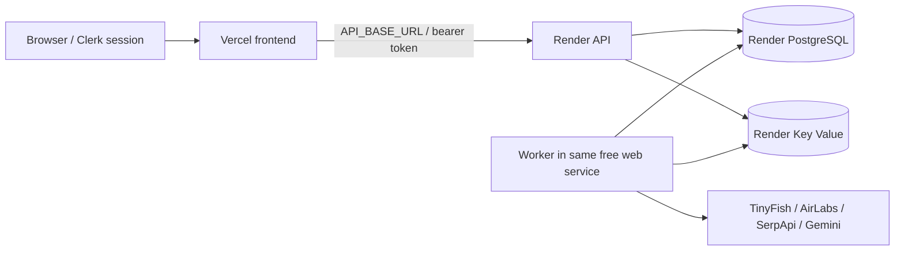

# Deploy TripSaathi: Vercel + Render

## Why the deployed UI says “Server unavailable”

Vercel hosts the Next.js frontend. It does not start this repository's separate NestJS API, BullMQ worker, PostgreSQL or Redis. A rewrite to `127.0.0.1:4000` points at Vercel's own machine, not your laptop. API keys cannot fix a missing server.



The default `render.yaml` selects **only free plans**: one web service running API and worker as separate child processes, free PostgreSQL and free Redis-compatible Key Value. It contains no separate paid worker, persistent disk or paid pre-deploy hook. No resource is provisioned by committing the file.

**This is a demo hosting profile, not always-on monitoring.** After 15 minutes without incoming traffic, Render's free web service can sleep; the API and worker pause together. Waking it can take time, and due checks may be missed. Free PostgreSQL expires after 30 days and free Key Value can lose queue data on restart. Persistent workflow state remains in PostgreSQL while that database is available; reconciliation does not recreate evidence from missed monitoring. Review [Render's free limits](https://render.com/docs/free).

This removes the paid selections that triggered the payment-method requirement. Render may independently require account/security verification; code cannot bypass that. If a card is still required after the screen shows all plans as Free, stop there and report the exact message. Do not select an upgrade to continue.

## 1. Create the backend resources

1. Sign into Render and connect GitHub access to `aayyuusssh/TripSaathi`.
2. Choose **New → Blueprint**, select this repository and branch **main**, and use root `render.yaml`.
3. Review **three resources, all Free**: `tripsaathi-api` (includes the worker process), `tripsaathi-db`, and `tripsaathi-redis`. If a separate worker or paid plan is listed, refresh and load the latest `main` before continuing. The region is Frankfurt; database/Redis access stays internal.
4. Supply requested secrets through Render's dashboard. Do not put them in GitHub, screenshots or chat.
5. Apply after confirming only free resources are selected. The startup supervisor runs tracked migrations first, then starts the API and worker with the same environment. If migration fails, neither starts; if either process exits unexpectedly, the supervisor stops the other so the service can restart as a unit.

All backend services build from the **repository root**. Do not set their root directory to `apps/api` or `apps/worker`.

### Values requested by the Blueprint

| Value | What to use |
| --- | --- |
| `NEXT_PUBLIC_CLERK_PUBLISHABLE_KEY` | Same Clerk instance as the Vercel frontend. The API verifies session signatures through that instance's public JWKS; it does not need the Clerk secret key. |
| `IMPORT_ENCRYPTION_KEY` | One random 32-byte base64 value, shared by API/worker and retained across restarts/deploys. |
| `TINYFISH_API_KEY` | Existing TinyFish account key. |
| `GEMINI_API_KEY` | Existing Gemini account key. |
| `AIRLABS_API_KEY` | Existing AirLabs account key. |
| `SERPAPI_API_KEY` | Existing SerpApi account key. |

To generate a **new cloud** import encryption key in your own PowerShell and copy it directly to the clipboard:

```powershell
node -e "process.stdout.write(require('node:crypto').randomBytes(32).toString('base64'))" | Set-Clipboard
```

Paste it into Render's `IMPORT_ENCRYPTION_KEY` field and save it securely. Both child processes inherit the same service environment. Do not regenerate it on every deployment. A new key is appropriate for a new empty cloud database; migrating existing encrypted originals requires their original key.

The Blueprint wires hosted `DATABASE_URL` and `REDIS_URL` automatically. Do not copy local `127.0.0.1` database URLs. The cloud database starts empty; laptop trips are not automatically migrated. Provider keys can generally remain the same, subject to provider account limits shared across your local/cloud usage.

### Hosted backend settings

The Blueprint supplies these to API/worker:

```dotenv
APP_MODE=hosted
AUTH_MODE=clerk
WEB_ORIGIN=https://trip-saathi-sigma.vercel.app
FLIGHT_STATUS_PROVIDER=AIRLABS
```

Render supplies the API `PORT`; the API binds to `0.0.0.0`. Local `APP_MODE=demo` remains loopback-bound. Hosted startup rejects demo identity, local DB/Redis URLs, missing frontend origin and missing shared encryption key. Supplier actions still remain sandbox/user handoffs; `hosted` does not enable booking authority.

If your Vercel hostname changes, update `WEB_ORIGIN` on the combined backend service and redeploy. Use the exact origin with **no trailing slash**, path or wildcard. Only that origin is accepted for Clerk token `azp` checks in hosted mode. Preview domains are not automatically authorized.

## 2. Configure Vercel

After the Render API is live, copy its **public HTTPS origin**, for example `https://tripsaathi-api-xxxx.onrender.com`.

In **Vercel → Project → Settings → Environment Variables**, set:

```dotenv
AUTH_MODE=clerk
API_BASE_URL=https://YOUR-ACTUAL-API.onrender.com
NEXT_PUBLIC_CLERK_PUBLISHABLE_KEY=YOUR_MATCHING_CLERK_PUBLISHABLE_KEY
CLERK_SECRET_KEY=YOUR_MATCHING_CLERK_SECRET_KEY
```

Use real values, not the example placeholders. `API_BASE_URL` must be an HTTPS origin without `/v1`, `/api`, trailing slash or embedded credentials. It is a server configuration variable, not `NEXT_PUBLIC_API_BASE_URL`. Rewrites preserve `/api/v1/...` → backend `/v1/...`, forwarding the session bearer token.

Vercel does not need database, Redis, travel-provider or import encryption credentials. Those belong to backend services. The Clerk secret belongs only to the frontend's server environment; the publishable key is intentionally public. Use the same Clerk instance on frontend and API. For a production Clerk instance, finish Clerk's domain setup and supply its matching live keys; don't mix development/live instances.

Build settings:

| Setting | Value |
| --- | --- |
| Root Directory | `apps/web` |
| Framework | Next.js |
| Build Command | `pnpm run build` |
| Include source files outside Root Directory | Enabled |

Create a deployment from latest `main` **after** adding variables. API destination and public identity settings are used during the frontend build; changing them requires a new deployment. Vercel builds now fail with an actionable message instead of silently choosing localhost/demo identity.

## 3. Verify the actual deployment

1. Open `https://YOUR-ACTUAL-API.onrender.com/v1/health`. Expect a TripSaathi JSON response with `database: connected` and Clerk authentication. This endpoint is diagnostic; HTTP 200 alone does not prove database/worker readiness.
2. Open `https://trip-saathi-sigma.vercel.app/api/v1/health`. Expect the same API response through Vercel, not an HTML error or private-address resolution error.
3. Sign into the web app. Trip listing should load. An empty new cloud database is normal.
4. Open **System health**: Redis should be CONNECTED and the worker ONLINE. An API response alone does not verify job processing.
5. Run a separate sandbox rehearsal and confirm queued actions complete. Then test real research/monitoring explicitly, reviewing quotas and provenance.
6. Without a bearer token, a direct request to `/v1/trips` must return 401. Validate owner isolation before adding sensitive documents.

| Symptom | Check |
| --- | --- |
| Private-address resolution error / 502 / server unavailable | Correct public `API_BASE_URL`, redeployed frontend and running Render API. |
| 401 after sign-in | Same Clerk instance on both services; exact `WEB_ORIGIN` must match token/application origin. |
| Database unavailable | Render migrations/logs and internal PostgreSQL connection. |
| Worker unavailable / queued work stuck | Wake the API service; check its combined API/worker startup, Redis, migrations and logs. |
| Imports cannot decrypt | API/worker use the same retained encryption key. |
| No old laptop trips | New hosted database is separate from local Docker data. |

## Operations and remaining limits

This adds hosting configuration and startup/auth guards; it is not a claim of completed cloud acceptance or production certification. Review backups, provider budgets, log redaction, retention, abuse/rate limits and monitoring before inviting public users. SSE availability/duration also depends on the hosting proxy; snapshot polling remains the UI fallback.

The free API and worker share a small memory allowance. Large uploads/extraction or concurrent jobs may exhaust it; that capacity has not been verified on Render. There are no keepalive pings or attempts to bypass sleep/usage limits. Provider API credits remain separate from hosting and may still cost money. Export/back up important data before the free database expiry; this template is intended for short demos.

Keep provider caps aligned if overriding defaults on API/worker. Do not enable automatic retries for uncertain paid research. API/worker restarts do not authorize supplier purchases, refunds or rail consumer-account automation.

References: [Render Blueprints](https://render.com/docs/blueprint-spec), [background workers](https://render.com/docs/background-workers), [environment variables](https://render.com/docs/configure-environment-variables), [Vercel monorepos](https://vercel.com/docs/monorepos).
