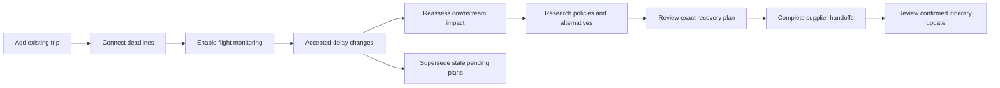
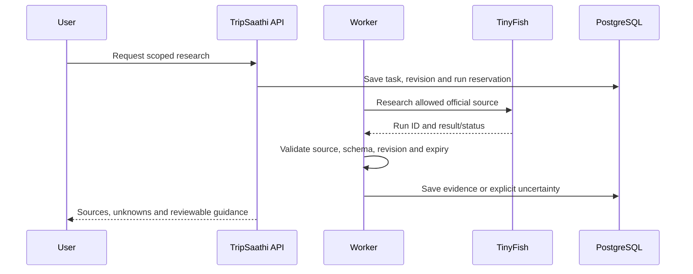
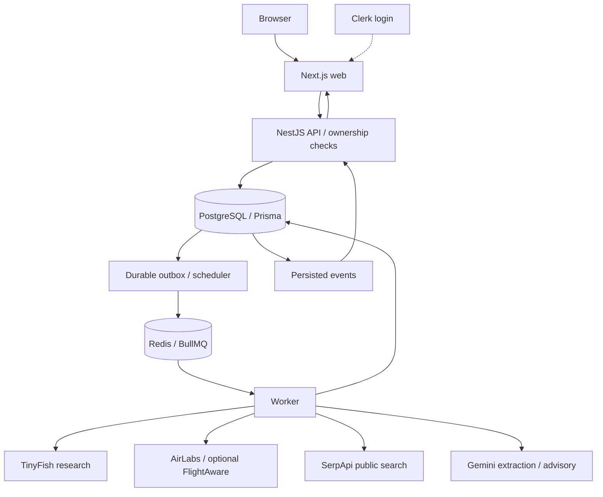

<div align="center">

# TripSaathi

### One delay. A whole itinerary at risk. A clearer way forward.

A trip recovery workspace connecting flights, trains, hotels and pickups—so a changing arrival time becomes a reviewed recovery plan.


[Quick start](#quick-start) · [Workflow](#try-the-workflow) · [TinyFish](#where-tinyfish-fits) · [Architecture](#architecture) · [Configuration](#configuration) · [Testing](#testing)

</div>

---

## Why TripSaathi?

Your flight is delayed by an hour. Then two more. Your hotel has a late-arrival deadline, your pickup is scheduled, and an onward connection is getting tighter.

A status update tells you what happened to the flight. TripSaathi helps you understand **what it means for the rest of your trip, what needs attention, and what to do next**.

Add an existing itinerary without booking through TripSaathi. Connect its dependencies, monitor supported flights, investigate official policies, compare public alternatives, and review recovery steps before acting.

> **Current scope:** a local recovery application with live-provider integrations, explicit user handoffs and separate sandbox rehearsals. Supplier booking, payment, cancellation and refund execution are not implemented. Live train status requires an authorized rail provider. Production hosting is not enabled.

## What you can do

| Feature | How it helps |
| --- | --- |
| **Add an existing trip** | Keep externally booked flights, trains, hotels and transfers in one workspace. |
| **Import a confirmation** | Upload PDF, PNG, JPEG or TXT; optionally use consent-based Gemini extraction, then review before saving. |
| **Connect the itinerary** | Record deadlines, reporting buffers and onward dependencies, including separate flight arrival timezones. |
| **Monitor supported flights** | Opt into AirLabs checks; review timestamps, freshness, provenance and missing coverage. FlightAware is optional. |
| **Handle growing delays** | Reassess downstream impact and supersede pending plans tied to older revisions. |
| **Research with TinyFish** | Investigate official policies/contextual fallbacks; inspect sources, unknowns and expiry. |
| **Compare alternatives** | Search public flight/hotel observations through SerpApi; review dates, occupancy and price basis. |
| **Review recovery** | Shortlist a current option, approve exact guidance, and follow ordered supplier handoffs. |
| **Record confirmed changes** | Explicitly review and apply confirmed flight/hotel details after completing handoffs. |
| **Stay informed** | In-app inbox, worker health, event updates and redacted trip reports. |
| **Rehearse safely** | Separate, labelled sandbox trips with 1-hour → 3-hour delays and sandbox execution. |

### What “real” means here

| Data/action | What it proves |
| --- | --- |
| Accepted live flight observation | Provider response matched service, route and schedule and supplied required ETA/actual fields. Coverage varies. |
| TinyFish evidence | Research passed source/schema/revision checks; not ticket-specific eligibility or confirmed inventory. |
| Public price | An expiring observation, not held inventory or a guaranteed payable quote. |
| Existing-trip completion | **User-reported** supplier outcome, not independently verified ticket/hotel confirmation. |
| Sandbox confirmation | Simulated rehearsal outcome, never a supplier transaction. |

## Try the workflow



1. **Create your itinerary.** Use actual booking details, or clearly label a public-service test and leave unbooked arrangements `UNKNOWN`. Each flight leg is separate.
2. **Add dependencies.** Connect hotel, pickup and onward travel. Check local dates, IANA timezones and assumed deadlines.
3. **Enable monitoring explicitly.** Review accepted observations and freshness. Import alone does not enable polling.
4. **Investigate impact.** Request TinyFish research and public searches when needed. Opening a trip does not start paid research.
5. **Review Recovery.** Select a fresh alternative and approve exact steps. Existing-trip guidance authorizes **zero supplier spending**.
6. **Act with the supplier.** Record the actual outcome/reference. Reconcile uncertainty before dependent steps proceed.
7. **Apply reviewed details.** Explicitly update the app itinerary. Flight changes require monitoring reconfirmation and downstream review.

<details>
<summary><strong>First demo: rehearse a growing delay</strong></summary>

Open **Guided rehearsal**, create a separate sandbox itinerary and apply **+1 hour**. Review/approve recovery, then apply **+3 hours total**. Older pending plans should become superseded; completed actions remain historical. Review revised recovery, worker results, inbox and report.

This tests simulation, not live-provider coverage. TinyFish research remains explicit and may consume credits even from a rehearsal.

</details>

## Where TinyFish fits

TinyFish is the **public web research layer**, invoked for a specific investigation rather than every status poll.



- **Official policies:** investigate relevant public airline disruption/hotel arrival passages.
- **Contextual fallbacks:** investigate permitted alternatives with limited itinerary/impact context.
- **Traceable evidence:** retain run identity, sources and unknowns. Stale/off-source results cannot silently support new approvals.
- **Uncertain-run recovery:** inspect a matching existing run after timeout/uncertain start without automatically launching another task.

Sources are predefined official pages, including selected IndiGo/IHG sites. This is not unrestricted booking-site automation. Customer credentials, PNRs and contact fields are excluded from research context. Blocked/not-found/uncertain results remain visible.

**Responsibilities:** AirLabs supplies flight observations; deterministic domain rules assess impact/approval validity; TinyFish supplies web evidence; SerpApi supplies price observations; Gemini provides optional advisory explanations and consent-based extraction.

## Architecture

A **TypeScript modular monolith with a separate worker** shares rules while keeping long tasks outside web requests.



| Layer | Technology |
| --- | --- |
| Web | Next.js 16, React 19, Tailwind CSS, TanStack Query |
| API | NestJS 11, REST/OpenAPI, owner-scoped access |
| Domain | TypeScript/Zod schemas, timing rules, exact approvals |
| Persistence | PostgreSQL 17, Prisma 6, tracked migrations |
| Jobs | Redis 7, BullMQ, outbox/reconciliation |
| Identity/updates | Clerk or local demo; authenticated SSE/polling |
| Tooling | Node.js 22+, pnpm workspace, Docker Compose, Vitest |

PostgreSQL owns state; Redis delivers jobs. Revision/digest, expiry and permission scope are checked before advancement. Idempotency and database locking protect duplicate sandbox execution. Changed observations invalidate pending stale approvals without erasing completed history.

```text
TripSaathi/
├── apps/
│   ├── web/          # UI and authenticated API proxy
│   ├── api/          # Trip, import, research and recovery services
│   └── worker/       # Monitoring, provider tasks and notifications
├── packages/
│   ├── domain/       # Shared schemas, rules and unit tests
│   └── database/     # Prisma schema and migrations
├── scripts/          # Setup, diagnostics and regressions
├── .env.example
├── docker-compose.yml
└── ACCEPTANCE.md
```

## Quick start

### Prerequisites

- **Node.js 22+**, including npm, and **Git**.
- **Docker Desktop** with its Linux engine running.
- **Windows PowerShell** for the included wrapper.
- Local ports **3000, 4000, 5432 and 6379** available.

### 1. Clone and provision

```powershell
git clone https://github.com/aayyuusssh/TripSaathi.git
cd TripSaathi
powershell -NoProfile -ExecutionPolicy Bypass -File scripts/project.ps1 setup
```

Setup installs project-local pnpm 10.32.1 and dependencies, creates `.env` only if absent, starts PostgreSQL/Redis, generates Prisma Client, deploys migrations and builds shared packages. It does **not** install Node/Docker or start application servers.

### 2. Start the application

```powershell
powershell -NoProfile -ExecutionPolicy Bypass -File scripts/project.ps1 dev
```

Keep this terminal running: it starts **web, API and worker** together.

| Service | Address |
| --- | --- |
| Application | [127.0.0.1:3000](http://127.0.0.1:3000) |
| Interactive API docs | [127.0.0.1:4000/docs](http://127.0.0.1:4000/docs) |
| API health | [127.0.0.1:4000/v1/health](http://127.0.0.1:4000/v1/health) |

### 3. Check a second terminal

From the project root:

```powershell
node scripts/doctor.cjs
```

Start with **Guided rehearsal**, or configure providers for live observations. The template defaults to `AUTH_MODE=demo`, a local demo identity. Use Clerk for separate signed-in accounts.

<details>
<summary><strong>Manual setup without the PowerShell wrapper</strong></summary>

Install pinned pnpm, then copy `.env.example` to `.env` using your editor/operating system before running the remaining commands:

```sh
npm install --global pnpm@10.32.1
pnpm install
docker compose up -d --wait
pnpm db:generate
pnpm db:deploy
pnpm build:packages
pnpm dev
```

Windows/OneDrive users should use `scripts/project.ps1`: it includes this host's realpath compatibility preload and refreshes internal package copies when junction creation is unavailable. The manual path is not a claim of separate cross-platform acceptance testing.

</details>

## Configuration

Edit the **ignored root `.env`**, then restart development processes. Never commit real keys or paste them into issues.

| Capability | Variables | Requirement |
| --- | --- | --- |
| Persistence/jobs | `DATABASE_URL`, `REDIS_URL` | Required; Docker defaults provided. No external DB API key. |
| Local demo | `APP_MODE=demo`, `AUTH_MODE=demo` | Default; not private multi-user authentication. |
| Managed login | `AUTH_MODE=clerk`, `CLERK_SECRET_KEY`, `NEXT_PUBLIC_CLERK_PUBLISHABLE_KEY` | Matching Clerk development key pair. |
| TinyFish | `TINYFISH_API_KEY` | Real public web research. |
| Flight monitoring | `AIRLABS_API_KEY`, `FLIGHT_STATUS_PROVIDER=AIRLABS` | Selected live checks; coverage still matters. |
| Flight/hotel search | `SERPAPI_API_KEY` | Public observations, not ticket issuance. |
| AI explanation/extraction | `GEMINI_API_KEY` | Optional; extraction also requires consent. |
| Import encryption | `IMPORT_ENCRYPTION_KEY` | Optional base64 32-byte key; otherwise generated in `.private/keys/imports.key`. |
| Alternate flight status | `FLIGHTAWARE_API_KEY`, `FLIGHT_STATUS_PROVIDER=FLIGHTAWARE` | Optional adapter. |

FlightAware/Amadeus signup is **not a prerequisite** for the AirLabs/SerpApi flow. Future-provider placeholders do not activate integrations merely because a key is supplied. See [.env.example](.env.example) for supported settings.

<details>
<summary><strong>Managed login, imports and privacy</strong></summary>

Set Clerk mode and both keys, restart, then sign in through the app. Backend checks scope private trips, originals, reports and notifications to their owner. Demo trips are not automatically transferred to the first signed-in account.

Uploads accept one PDF/PNG/JPEG/UTF-8 TXT up to **5 MB**. Retained originals use AES-256-GCM with owner/record binding. Back up the encryption key separately: losing it makes originals unreadable. This does not encrypt all itinerary metadata or the entire database.

Gemini extraction sends the **complete file** only with explicit consent. Review fields before saving. Default original/draft retention is 24 hours; removal after save is selected by default. Local deletion cannot undo external provider processing.

</details>

<details>
<summary><strong>Polling, quotas and evidence expiry</strong></summary>

These are application request caps, not provider entitlements or monetary guarantees:

| Operation | Default |
| --- | --- |
| AirLabs installation | 10 requests/UTC day, 50/month; 10-hour monitoring lead window. |
| Trip monitoring | 24 requests/UTC day, configurable 4–96; provider caps also apply. |
| Optional FlightAware installation | 200 requests/UTC day. |
| TinyFish | 3 reserved runs/trip/rolling 24 hours. |
| SerpApi | 50 installation searches/month shared by flights/hotels; each search kind allows 2/trip/rolling 24 hours. |
| Gemini explanation | 2 reserved requests/trip/rolling 24 hours. |
| Gemini extraction | 3 reserved requests/owner/rolling 24 hours. |

Checks generally tighten from 30-minute to 5-minute intervals near travel, with failure backoff. Windows, caps and coverage can leave gaps. No system knows an unannounced future delay with certainty.

Public alternatives have a **10-minute review window**; policy evidence typically one day. Revision changes can invalidate evidence earlier. Uncertain dispatches can consume a reservation and are not silently repeated. Leave `TINYFISH_CALLBACK_BASE_URL` unset locally; polling needs no public tunnel.

</details>

## Testing

### Automated local acceptance

With PostgreSQL and Redis running:

```powershell
powershell -NoProfile -ExecutionPolicy Bypass -File scripts/project.ps1 verify
```

This runs domain tests, workspace type checks, production builds and **12 isolated database/worker regression suites**. It migrates a disposable local PostgreSQL schema and cleans it afterward. Provider responses/reports are synthetic; no travel-provider calls or purchases are made. Results are saved to ignored `verification/local-acceptance.json`.

| Command | Purpose |
| --- | --- |
| `node scripts/doctor.cjs` | Configuration presence and reachability; no key values. |
| `powershell -NoProfile -ExecutionPolicy Bypass -File scripts/project.ps1 check` | Domain tests and type checks. |
| `powershell -NoProfile -ExecutionPolicy Bypass -File scripts/project.ps1 build` | API, worker and web production builds. |
| `powershell -NoProfile -ExecutionPolicy Bypass -File scripts/project.ps1 verify` | Full synthetic local acceptance. |

See [ACCEPTANCE.md](ACCEPTANCE.md) for signed-in browser checks and verification boundaries.

### Recorded verification

During local development on **15–16 October 2026**:

- Domain/identity/client-transport tests, workspace checks, production builds and 12 isolated regression suites passed.
- Signed-in browser acceptance covered trip listing, growing sandbox delays, stale-plan supersession, exact approval, worker execution, private synthetic upload/download, redacted export and health. Anonymous/invalid private API requests returned 401.
- Separate real-call checks observed accepted AirLabs status, SerpApi flight/hotel results, TinyFish policy/API access, and Gemini explanation/synthetic-document extraction.

These are scoped historical observations, not current uptime guarantees or universal coverage. Runtime proof artifacts are excluded from Git. A prior uncertain TinyFish hotel-alternatives attempt was not relabelled as successful live research.

<details>
<summary><strong>Explicit live-provider checks — may consume credits</strong></summary>

Build first and choose only the check you need:

```powershell
node scripts/tinyfish-smoke.mjs
node scripts/gemini-smoke.mjs
node scripts/verify-alternative-providers.mjs
```

These make external requests and are excluded from routine acceptance. Inspect the script/quota before running; do not automatically repeat uncertain submissions. Blocked/not-found/timeout outcomes can be legitimate.

The legacy `scripts/integration.mjs` HTTP check needs `AUTH_MODE=demo` and running API/worker. Anonymous requests correctly receive 401 in managed mode; use full verification and signed-in acceptance instead.

</details>

## Troubleshooting

<details>
<summary><strong>Docker is running, but the app is unavailable</strong></summary>

Docker supplies PostgreSQL/Redis, not application processes. Run `setup`, then keep `dev` running. Check `node scripts/doctor.cjs` in another terminal.

</details>

<details>
<summary><strong>ECONNREFUSED port 4000 / web not reachable</strong></summary>

Wait for web **Ready** and API **successfully started**. Confirm dev is running and inspect its first error. Use `http://127.0.0.1:3000` consistently. A refused API connection does not require another database key.

</details>

<details>
<summary><strong>Prisma generation fails with a Windows DLL lock</strong></summary>

Stop TripSaathi dev with Ctrl+C before setup/client generation, then restart. Running API/worker processes can hold Prisma's engine DLL. Do not delete database volumes to fix a client-file lock.

</details>

<details>
<summary><strong>Keys configured, but no live result</strong></summary>

Restart after editing `.env`; explicitly enable monitoring/request research. Check coverage, service/date/route, quota, source access, task outcome and worker health. Key presence alone does not prove ETA coverage, inventory or completed research. Missing data stays unverified.

</details>

<details>
<summary><strong>Recovery or notifications seem stuck</strong></summary>

Check **System health** for Redis and current worker heartbeat. Review prerequisites, plan expiry/revision and uncertain actions. Inspect the actual supplier record before reporting/reconciling outcomes. The inbox requires the worker.

</details>

## Current boundaries and future scope

**Implemented:** connected itineraries, adaptive impact analysis, supported live flight monitoring, public research/search, exact approvals, user handoffs, reviewed flight/hotel updates, private imports, managed identity, in-app notifications and local acceptance tooling.

**Future:** authorized supplier inventory/booking/servicing, payments/refunds, authorized live rail status, external notifications and production hardening. IRCTC consumer-account automation is not implemented.

The modular design leaves room for a booking platform later. Importing a reservation or approving guidance today does not grant authority to change that reservation with a supplier.

## Documentation

| Document | Purpose |
| --- | --- |
| [Acceptance checklist](ACCEPTANCE.md) | Automated/browser checks and supplier boundaries. |
| [Environment template](.env.example) | Supported configuration and local defaults. |
| [Technical architecture](TripSaathi-Technical-Architecture.md) | Module design and longer-term plan; some sections describe future scope. |
| [Implementation history](PROGRESS.md) | Milestones, verification and outstanding work. |
| [Credential setup notes](SETUP-KEYS.md) | Historical setup/provider notes; use this README and environment template for the current overview. |

## Contributing and reporting issues

Open an [issue](https://github.com/aayyuusssh/TripSaathi/issues) with reproduction steps, expected/actual behaviour, runtime versions and redacted logs. State whether the trip is live/imported/sandbox. Remove keys, tokens, booking references and passenger information.

For changes, preserve provenance and exact approval checks, document new variables with empty secrets in `.env.example`, and run relevant checks above. Use synthetic provider fixtures unless a real call is explicitly intended.

## License

No license file is currently included. Contact the repository owner for permission to reuse or redistribute the code.

---

<div align="center">

Built by [Ayush Gupta](https://github.com/aayyuusssh) · [Report an issue](https://github.com/aayyuusssh/TripSaathi/issues) · [Back to top](#tripsaathi)

</div>
