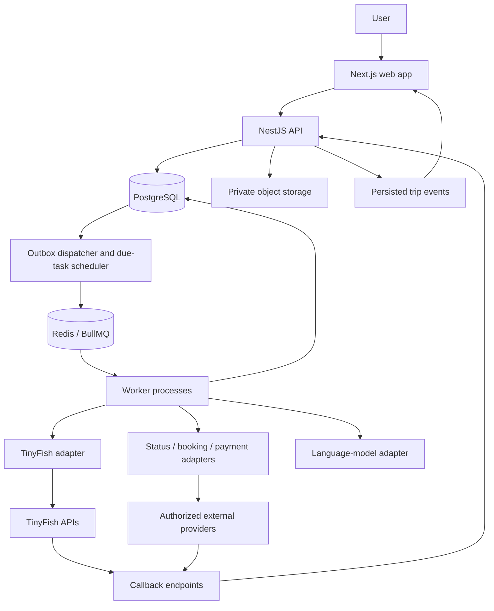

# TripSaathi — Technical architecture and implementation plan

Prepared 14 October 2026. This is a proposed architecture, not a claim of implemented integrations or live website validation.

Hosting update (16 October 2026): the default Render Blueprint is a free demo profile. A supervisor runs migrations and then separate API/worker child processes inside one free web service, with shared hosted PostgreSQL/Redis and managed identity. Both processes stop when the service sleeps; free database expiry and queue-loss limits apply. This co-location changes deployment only, not module boundaries, and does not provide continuous monitoring. See DEPLOYMENT.md.

## 1. Product and architecture decision

Build an existing-trip recovery platform first. Users add flights, trains, hotels and transfers purchased elsewhere. The system records dependencies, monitors supported services, detects downstream risk, investigates recovery options, requests precise approval and verifies action outcomes. Future bookings created inside TripSaathi produce the same trip records and use the same monitoring and recovery pipeline.

Choose a TypeScript modular monolith with independently deployed API and worker processes. Modules share one PostgreSQL database through owned repositories. External provider integrations use capability-specific adapters. Durable workflow state lives in PostgreSQL; Redis/BullMQ transports jobs. AI outputs are proposals and extracted observations; deterministic application rules authorize actions and validate timing/cost.

The design makes code integration manageable. Supplier authorization, inventory access, ticket issuance, settlement and post-booking servicing remain business dependencies.

## 2. Selected stack

| Component | Selection | Responsibility |
|---|---|---|
| Web client | Next.js App Router, React, TypeScript | Trip entry, timeline, recovery comparison, approvals and action tracking |
| UI | Tailwind CSS, accessible component library | Consistent forms, status cards and responsive views |
| Client data | TanStack Query; React Hook Form + Zod | API state, form validation and refresh after events |
| API | NestJS, REST, OpenAPI | Authentication, module services, authorization and external callbacks |
| Persistence | PostgreSQL + Prisma | Trips, observations, plans, approvals, actions and migrations |
| Background processing | BullMQ + Redis | Due monitoring checks, TinyFish jobs, reconciliation and notifications |
| Object storage | Private S3-compatible bucket | Uploaded confirmations and permissioned evidence artifacts |
| Authentication | Managed OIDC identity provider | Login; API verifies issuer, audience and tokens |
| AI | Provider-neutral language-model adapter | Document extraction, policy explanation and constrained plan proposals |
| Web execution | TinyFish HTTP client behind adapter | Selected permitted web investigation and action tasks |
| UI updates | Authenticated SSE + snapshot REST endpoints | Trip events; reconnect retrieves current state and events after cursor |
| Development | pnpm workspace, Docker Compose | Shared contracts; local Postgres, Redis and object storage |
| Verification | Vitest/Jest, Playwright, integration database | Rules, concurrency, adapters, worker recovery and UI flows |
| Operations | Structured logs, OpenTelemetry-compatible traces, error tracking | Run latency, stuck actions, failures and integration costs |

Pin compatible stable releases when scaffolding. Use one package manager and lockfile. PostgreSQL is the authoritative store; Redis is neither the booking record nor the approval store.

Official references: [Next.js App Router](https://nextjs.org/docs/app), [NestJS modules](https://docs.nestjs.com/modules), [NestJS BullMQ integration](https://docs.nestjs.com/techniques/queues), [Prisma transactions](https://www.prisma.io/docs/orm/fundamentals/transactions).

## 3. Deployment topology



Deploy web, API and worker as separate processes. Host API/worker on infrastructure that supports long-running processes and public HTTPS callbacks. Web requests acknowledge work with an operation ID; users do not wait for a browser task inside one HTTP response.

Local Compose supplies infrastructure. Production uses backups, persistent queue storage, secret management, health checks and independently adjustable worker concurrency. Restrict the job-dashboard endpoint to administrators.

## 4. Module boundaries

| Module | Owns | Depends on |
|---|---|---|
| Identity/access | Users, trip roles, consent | OIDC provider |
| Trip | Itinerary items, travellers, dependencies, constraints | Identity |
| Import | Upload lifecycle, parsed drafts, user verification | Trip, object storage, extraction adapter |
| Provider registry | Provider configurations, capability/access flags | Integration adapters |
| Monitoring | Service instances, subscriptions, observations, freshness | Status adapters |
| Impact | Timing and deadline assessments | Trip, monitoring |
| Evidence | Policy facts, provenance, validity scope | TinyFish, provider responses |
| Recovery | Candidates, validated plans, costs and plan versions | Impact, evidence, offer search |
| Approval | Approval scope, expiry, withdrawal | Recovery, identity |
| Execution | Action graph, attempts, external references and reconciliation | Approval, provider adapters |
| Notification | Notification preferences and delivery | Trip events |
| Commerce, future | Offers, carts, orders and booking records | Inventory/order adapters, trip |
| Payments, future | Charges, refunds, reconciliation and ledger | Payment provider, commerce |

Modules expose services and typed contracts. One module does not update another module's tables directly. A database transaction may atomically update a business record and its outbox event. Avoid holding a database transaction open during network calls.

## 5. Data model designed for recovery and booking

**Trip**: owner, members, status, preferences, budget and version.

**TripItem**: category `FLIGHT | RAIL | HOTEL | TRANSFER | ACTIVITY`, lifecycle, provenance `IMPORTED | PLATFORM`, locations, timestamps and provider reference. Importing an item records the external arrangement; it does not grant servicing authority. Some items may be plans with no confirmed reservation.

**Category detail tables** preserve differences:

- Flight: operating/marketing carrier, flight number, departure service date, airports, segments, fare/baggage metadata and ticket reference where supplied.
- Rail: train number, origin start date, user boarding date, boarding/alighting stations, class, quota and per-passenger confirmed/RAC/waitlist state where verified. A train's source date and the user's boarding date may differ.
- Hotel: property, room/occupancy, local check-in/out dates, confirmed late-arrival conditions and contact route.
- Transfer: pickup location/window, destination, passenger/luggage capacity and cancellation/change conditions.

**Dependency**: preceding/following items, dependency type, transfer duration, reporting buffer and provenance. Distinguish a physically tight connection from a contractually protected through-booking. User-entered assumptions remain labelled.

**ServiceInstance**: identifies the actual flight/train run; enables shared public monitoring across multiple users. Rail observations must be station-specific when assessing boarding or arrival.

**StatusObservation**: source, provider event ID, provider timestamp, observed timestamp, scheduled/estimated/actual times, affected location, raw-response reference and provenance `LIVE | SANDBOX | REPLAY | USER_REPORTED`. Preserve history and build current projections using provider-specific ordering rules.

**MonitoringSubscription**: service instance, interested trip, start/end dates, next check, priority and coverage status.

**PolicyFact / Evidence**: URL/provider, retrieval time, relevant passage, applicable ticket/property scope, interpretation and expiry. General policy alone cannot establish ticket-specific eligibility.

**ImpactAssessment**: trip revision, observation set, constraint, outcome `FEASIBLE | AT_RISK | ACTION_REQUIRED | UNKNOWN`, explanation and assessment timestamp. A time-feasible rail option with waitlisted status is not a confirmed recovery option.

**OfferSnapshot**: provider, category-specific offer token, observed price, currency, availability meaning, restrictions, retrieval/expiry time and evidence. Observed prices without provider-guaranteed validity require revalidation.

**RecoveryPlan / PlanAction**: trip revision, input observations, candidate items, ordered dependencies, risk/unknown fields, expiry and version.

**Approval**: actor, exact plan/action digest, allowed suppliers/items, maximum spending, currency, material conditions, expiry, approval time and withdrawal status.

**ActionAttempt**: action key, idempotency key, expected state, provider request/reference, TinyFish run ID if applicable, attempt timestamps, execution state and verification evidence.

**EventInbox / EventOutbox / TripEvent**: deduplication, reliable job dispatch and user-visible history. Store only redacted payloads or private references where appropriate.

**ProviderConnection / AgentTask**: user/provider access reference, capability scope, profile reference where supported, task template version, status, result/evidence references and resource usage.

Future **Order**, **OrderItem**, **Payment**, **Refund** and **LedgerEntry** records connect to TripItems. Creating a trip item is distinct from ticket issuance or supplier confirmation.

Common conventions: opaque internal IDs; money in integer minor units plus currency; UTC instants plus IANA local timezone; explicit local dates for hotels and service-date identity; nullable unknown fields; separate scheduled, estimated and actual time columns. Convert currency only with an explicit rate/time/source; preserve original amounts.

## 6. Provider integration contracts

Use separate interfaces rather than a universal provider with every possible operation:

```ts
type TravelCategory = 'FLIGHT' | 'RAIL' | 'HOTEL' | 'TRANSFER';

interface StatusProvider {
  getStatus(input: StatusQuery): Promise<StatusObservation[]>;
}

interface InventoryProvider {
  search(input: SearchQuery): Promise<OfferSnapshot[]>;
  revalidate(input: OfferReference): Promise<OfferSnapshot>;
}

interface OrderProvider {
  create(input: ApprovedOrderRequest): Promise<OrderOutcome>;
  getOrder(input: OrderReference): Promise<OrderOutcome>;
}

interface ServicingProvider {
  quoteChange(input: ChangeQuery): Promise<ChangeQuote>;
  applyChange(input: ApprovedChange): Promise<ActionOutcome>;
  quoteCancellation(input: CancellationQuery): Promise<CancellationQuote>;
  cancel(input: ApprovedCancellation): Promise<ActionOutcome>;
}
```

These are proposed internal contracts, not TinyFish API endpoints. Category-specific query/result types preserve flight segments, rail confirmation states, room policies and cab capacity. Optional supplier capabilities include holds, ticket issuance, refunds and asynchronous confirmation. An adapter advertises only actually implemented and authorized operations.

Each capability specifies: access status, enabled environments, permission review, read/write mode, idempotency support, rate limits, geographic/service coverage and reconciliation method. Unsupported operations return a typed unsupported result; they never silently switch to browser execution.

Adding a supplier means implementing the relevant adapter, mapping its data, testing failures and enabling approved capabilities. Adding a category also requires its rules and UI; an adapter alone cannot supply category-specific logic.

## 7. Monitoring and repeated-delay flow

1. Confirm imported identifiers and register a service-instance subscription.
2. Use authorized event feeds where available, with scheduled status verification for missed events and freshness.
3. Apply provider rate limits, check windows and disruption priority. Example intervals are configurable, not a guaranteed real-time SLA.
4. Persist incoming observations and deduplicate. Reject invalid payloads; quarantine ambiguous/out-of-order information instead of overwriting newer state blindly.
5. Recalculate affected dependencies, including adjacent transfers and hotel decisions. Preserve source conflicts explicitly.
6. Escalate based on consequences/deadlines, not a universal number of delayed minutes.
7. Run expensive investigation when impact materially changes, a deadline approaches or offers need refresh. Reuse still-valid evidence and shared searches where appropriate.
8. Increment the trip/planning revision. Discard completed research belonging to obsolete revisions or retain it only as history.
9. Revalidate pending approved actions. An approval survives only if its explicitly approved conditions still hold.
10. Stop completed transport monitoring while keeping pending servicing/refund tasks active as needed.

Update the UI with last successful check, source, estimated time and stale/conflicting status. App closure does not stop backend work. A periodic reconciliation scan reconstructs missed jobs from PostgreSQL when queue delivery or worker processes fail.

## 8. Impact and recovery engine

Represent trip dependencies as a directed acyclic graph; validate cycles at import/edit. Treat nonessential activities as optional rather than making every timeline item a hard dependency.

Evaluate earliest practical arrival using estimated service times, terminal/station exit, baggage, travel duration, reporting cutoffs and user constraints. Unknown transfer times or hotel agreements produce uncertain assessments. Safety buffers are sourced/user-configurable, not falsely precise guarantees.

Generate candidates in this order: preserve confirmed arrangements; investigate provider recovery; search replacements; consider overnight or alternate-route plans when needed. Candidate discovery may use AI, but timing, budget, capacity, rail ticket state, provider permission and evidence completeness are checked in code.

Show two or three useful plans with arrival time, additional payment now, confirmed charges, possible refunds later, assumptions and pending agreements. Never subtract an unapproved refund from money needed immediately. Prefer transparent preference-based ranking over an unexplained universal score.

Policy passages are source data, not application instructions. AI cannot create supplier offer IDs, action approval or confirmed outcomes. Explain unknowns and keep a valid 'continue waiting' option when appropriate.

## 9. TinyFish implementation

Put TinyFish access in `integrations/tinyfish` and invoke it through persisted AgentTasks. Keys stay on the server. Use template-defined URLs/goals, bounded inputs and validated structured results.

Task families: disruption-policy investigation; dynamic alternative search; fare/rule inspection; hotel conditions; booking-specific previews; explicitly permitted approved requests; confirmation verification. Search/Fetch handle suitable public discovery/reading; Agent handles selected dynamic navigation. Browser API is optional for a deterministic supported flow, not required for every task.

Run lifecycle:

1. Create AgentTask with trip/plan revision, task template, provider and environment.
2. Check permissions, budget, freshness and whether equivalent work already exists.
3. Start `POST /v1/automation/run-async`; store returned run ID.
4. Receive callback and/or poll `GET /v1/runs/{id}`.
5. Authenticate callbacks using documented mechanisms where available. Do not assume a universal signing scheme. For unknown/replayed callbacks, reject or ignore; retrieve the known run through the authenticated API before adopting a claimed result.
6. Validate output against application schemas and category rules; attach evidence and record source observation times.
7. Apply the result only to a still-relevant revision; publish a persisted application event.

For visible demos, `run-sse` can supply progress. A disconnected upstream stream recovers through run lookup, not by blindly starting a second task. Internal application SSE uses its own persisted event cursor and snapshot recovery. Optional screenshots/recording depend on account capability; textual/source evidence is the baseline.

TinyFish officially documents async/SSE runs, structured output, saved profiles and scoped Vault references. Strict mode/step caps and extra capture features have access gates; check entitlement before adding fields. [Agent reference](https://docs.tinyfish.ai/agent-api/reference), [profiles](https://docs.tinyfish.ai/agent-api/browser-context-profiles), [webhooks](https://docs.tinyfish.ai/webhooks), [structured output](https://docs.tinyfish.ai/key-concepts/structured-output).

Application safety is not guaranteed by an instruction saying 'do not submit'. Use narrow permitted flows and tested boundaries. Begin with public read-only investigations and a controlled supplier sandbox. For real writes, approval is checked before dispatch, but a running browser task cannot be assumed to support atomic pause/revalidation immediately before a website side effect. Enable only flows whose spend/conditions can be sufficiently constrained; otherwise hand off or use a transactional supplier API. Cancelling a run cannot undo an external action.

Authenticated profiles require verified user isolation and lifecycle handling before enabling multiple customers. Keep profile/credential references scoped, serialize conflicting actions against the same connection and support disconnect. A shared developer API key/password-manager account is not evidence of production multi-user credential isolation. Validate TinyFish account tenancy, credential ownership and storage arrangements first.

## 10. Approval, execution and durable workflows

Persist execution state:

```text
DRAFT -> VALIDATED -> AWAITING_APPROVAL -> APPROVED
      -> REVALIDATING -> EXECUTING -> VERIFIED

Branches: EXPIRED | SUPERSEDED | WITHDRAWN | FAILED
          PARTIALLY_COMPLETED | REQUIRES_USER | UNKNOWN_OUTCOME
```

Use an action dependency graph and action-specific attempts. Approval identifies exact version/conditions and maximum payable amounts. Recheck revision and approval under a database transaction before dispatch; use optimistic version checks or row locks for competing updates. Serialize side effects for an affected booking. Network calls happen after committing a persisted dispatch intent.

Publish jobs with a transactional outbox. Queue delivery is treated as at least once. Every handler uses stable task/action keys and unique constraints. PostgreSQL locks can protect competing record updates, but do not manufacture exactly-once effects at external providers. [PostgreSQL locking](https://www.postgresql.org/docs/current/explicit-locking.html).

Reads may retry with bounded exponential backoff. Writes retry only when the supplier supports idempotency or reconciliation proves no side effect occurred. A timeout after submit means `UNKNOWN_OUTCOME`; first inspect the provider record. Payment, booking, refund and TinyFish run lifecycles are separate.

If a replacement succeeds but hotel change fails, store both outcomes and produce a remaining recovery plan. Compensation is an explicitly permitted new action with its own cost/approval; cancellation is not assumed to be a free rollback. Irreversible actions require particular care with ordering, supplier confirmation and available holds.

## 11. Future booking integration

Future journey: search -> offer snapshot -> revalidate -> review -> approval -> order intent -> supplier confirmation/ticketing -> payment reconciliation -> confirmed TripItem -> monitoring.

Payment and supplier ordering depend on provider contracts; there is no universal charge-first sequence. Model authorization/capture/release and ticket issuance separately when supported. Hotel acceptance and rail confirmed/RAC/waitlist status retain their category meaning.

Future modules add inventory search, cart/order coordination, passenger details, payment handling, ticket/voucher fulfillment and servicing. Use provider idempotency and verified payment callbacks; store no raw card data. Financial records use immutable reconciled ledger entries and distinguish refund requested, approved and settled.

A basket containing flights/hotels/cabs does not create an atomic transaction across suppliers. Offer bundled checkout only when partial failure and user consent are explicitly designed.

IRCTC consumer website/mobile terms prohibit automation/scripting. Rail transactional capability requires an authorized integration or guided user completion; do not build consumer-account browser automation as a fallback. [IRCTC terms, page 7](https://contents.irctc.co.in/en/Terms%20and%20conditions.pdf).

## 12. APIs and repository structure

Initial REST surface:

| Route | Purpose |
|---|---|
| `POST /v1/trips` | Create existing trip |
| `POST /v1/imports` | Create private upload/import operation |
| `POST /v1/imports/:id/confirm` | Accept reviewed extraction |
| `POST /v1/trips/:id/items` | Add typed itinerary item |
| `PATCH /v1/trips/:id/items/:itemId` | Edit with expected revision |
| `POST /v1/trips/:id/monitoring` | Enable supported monitoring |
| `GET /v1/trips/:id/impact` | Latest assessment with freshness |
| `POST /v1/trips/:id/recovery` | Queue recovery operation; return operation ID |
| `GET /v1/recovery-plans/:id` | Plan, evidence and execution state |
| `POST /v1/recovery-plans/:id/approvals` | Approve exact digest/conditions |
| `POST /v1/approvals/:id/withdraw` | Withdraw permission for pending actions |
| `GET /v1/trips/:id/events` | Authenticated SSE/history cursor |
| `POST /v1/webhooks/tinyfish` | Receive run notifications |
| `POST /v1/webhooks/providers/:provider` | Provider-specific validation and inbox |

Server derives ownership and approval permissions from identity. Mutations use idempotency keys where applicable. Return operation IDs for queued work and explicit stale/unsupported/conflict states. Generate web-client API types from OpenAPI; use shared Zod schemas for internal payloads and TinyFish results.

```text
apps/
  web/
  api/
  worker/
packages/
  domain/          # Pure timing, money, impact and approval rules
  contracts/       # Schemas and internal event contracts
  database/        # Prisma schema, repositories and migrations
  integrations/
    tinyfish/
    status/
    inventory/
    servicing/
    payments/
  test-fixtures/   # Redacted and explicitly simulated scenarios
infra/
  compose/
docs/
  architecture/
  provider-capabilities/
  runbooks/
```

Keep API and worker business services shared through backend packages/modules; do not duplicate execution logic in frontend handlers. Start the repository with ADRs documenting provider boundaries, workflow consistency and TinyFish safety limits.

## 13. Implementation phases and acceptance gates

| Phase | Work | Acceptance gate |
|---|---|---|
| 0: Integration proof | Test TinyFish policy reading, one dynamic search and result validation; inventory data access and permissions | Real run IDs/evidence; supported-sites matrix; working sandbox and replay adapters |
| 1: Foundation | Workspace, CI, API/web/worker, database, authentication, outbox, schemas | Authorized user creates trip; job survives worker restart; another user cannot read it |
| 2: Trip and import | Typed flight/rail/hotel/transfer records, dependency graph, manual entry; document import after manual flow | Correct timezones, station/date identities, reviewed extraction and unknown fields |
| 3: Monitoring/impact | Adapters, scheduler, observations, stale/conflict states, deterministic impact rules | Delay sequence changes appropriate impacts; duplicate/old updates cause no duplicate actions |
| 4: Recovery | TinyFish tasks, evidence, offers, rules, comparison UI, planner/explanations | Plans use retrieved facts; impossible connections and unconfirmed seats rejected/labelled |
| 5: Approval/execution | Versioned approval, sandbox writes, reconciliation, handoff, confirmations | Price increase requests reapproval; timeout avoids blind retry; partial failure remains visible |
| 6: Demo/release | Notifications, traces, operational dashboard, rehearsals | Full scenario with live TinyFish research and labelled simulated status/actions; no undisclosed mock data |
| 7: Production pilots | Authorized status/servicing access, tenant review, support process | Verified provider contracts, coverage, spend constraints and incident ownership |
| 8: Booking expansion | Search/orders/payments/ticketing by category | Confirmed orders feed existing trip/recovery pipeline; payment and supplier states reconcile |

These are ordered work packages, not time guarantees. With a short hackathon window, prioritize manual trip entry, deterministic replay, one live TinyFish research flow, impact/recovery comparison and sandbox approval/verification. Add import OCR, real payments and multi-provider servicing after the core path is working.

## 14. Verification scenarios

1. Flight estimate moves by one hour, then two more; pickup and hotel impacts change while completed actions remain recorded.
2. Train crosses midnight; source start date differs from boarding date; downstream flight uses the correct station arrival.
3. Rail alternative is waitlisted: cannot appear as a confirmed available seat.
4. Duplicate webhook arrives and worker restarts: single persisted action identity and no blind resubmission.
5. Old research completes after trip edit: obsolete plan never becomes current.
6. Fare exceeds approved amount or policy materially changes: execution requires fresh approval.
7. Submit response times out: reconciliation before retry; unresolved result visibly unknown.
8. Replacement confirmed, hotel request denied: partial completion and updated remaining plan.
9. Source unavailable/conflicting: freshness and uncertainty shown, not invented on-time status.
10. Malicious document/page instruction attempts to trigger payment: treated as untrusted data, no new execution authority.
11. Cross-user trip/profile reference: access denied.
12. Reconnect UI after missing events: snapshot/cursor recovers current application state.

Use deterministic fixtures for edge cases, adapter contract tests for mappings and a controlled sandbox for side effects. TinyFish smoke tests target authorized pages with measured latency/cost and recorded outcomes.

## 15. Operations, costs and scope truth

Track trip/operation/task/run IDs throughout. Measure monitoring freshness, queued-task age, TinyFish result validity, research latency, cost per recovery, failed/unknown actions and notification delivery. Use provider-specific rate/concurrency caps, cache public evidence with expiry, budget per trip and circuit breakers for failing integrations.

Protect uploaded files with private storage, size/type limits, malware handling where appropriate, signed temporary download URLs and retention/deletion policies. Scope external navigation to approved domains; block private-network URLs and redirects; scrub tokens, PNRs, passwords and payment data from logs. Keep external page/document content outside trusted instruction paths.

Claim in a demo only what is implemented: live TinyFish research, persisted trip impact, comparison, exact approval and verified sandbox outcomes. Label replay/sandbox data throughout. No guarantee of final delay prediction, supplier agreement, refund eligibility or universal automated booking.

Ready-to-build outcome: a recovery system with shared itinerary foundations, persistent workflows and explicit provider capabilities, allowing future booking modules to join through the same orders-to-trip pipeline.

## Implemented Chunk 5 boundary

The web uses Next 16 proxy + Clerk managed sign-in; Nest independently verifies Clerk native session JWT signature/issuer/expiry/subject/authorized party and scopes all reads/mutations to the derived owner. Demo identity remains explicit/local only. Clerk credentials do not grant booking-provider authority. Human sign-in and UI verification remain an acceptance step.

DocumentImport stores encrypted original bytes, mutable extraction version/state, explicit Gemini consent/reserved call count, short retention and reviewed-confirmation digest. AES-GCM authenticates owner/record identity; encryption keys are separate ignored local files or configured secrets. Extracted metadata is private owner-scoped application data, not whole-database encryption. Worker claims exactly one extraction attempt; uncertain dispatch is not retried, and deleted/expired/version-changed documents reject late output. Review is explicit and validates existing domain schemas before atomic new-trip creation or revision-checked append. No document/page instruction can create approval or execution authority.

NotificationPreference, Notification and a locked persistent WorkerCursor implement bounded in-app delivery with unique source keys. Provider notifications are produced by persisted events, not guessed status. Simulation delivery is opt-in. Raw originals/drafts expire or can be removed; trip removal cascades itinerary/workflow state and purges linked imports. External provider data handling, Windows key protection, distributed rate limits, malware scanning, backups and production security review remain deployment work.

## Implemented Chunk 6 boundary

RuntimeService reads a bounded sample of TTL worker heartbeat records in Redis. WorkerHeartbeat publishes per-process records and progress for dispatch and monitoring loops. A sorted-set index is pruned during publishing, records expire after 35 seconds, API liveness is stale after 30 seconds and progress stalls/failures become degraded. Missing/unreachable Redis is unknown/unavailable, never healthy. This is local operational visibility, not distributed job tracing or provider readiness.

ReleaseService provides owner-scoped attention summaries and redacted per-trip snapshots. Research reuses the planner's usableEvidence schema/source/revision/expiry checks and requires a stored run identifier plus nonempty cited facts/candidates before the current-evidence checklist passes. The guided UI uses existing sandbox creation/replay/recovery APIs, exact revision approvals and stable replay keys. It does not create a second execution engine or silently launch paid research. Production contracts, real flight coverage, human browser verification and live TinyFish alternatives remain acceptance dependencies.

## Implemented Chunk 7 boundary

ResearchRecoveryService provides owner-guarded manual uncertain-run reconciliation through the existing durable outbox. Control metadata lives in the existing AgentTask context, is validated separately and is excluded from agent goal context. The worker persists dispatch correlation before calling TinyFish, then uses authenticated GET-only run search/inspection with exact original-goal/correlation/time matching. Truncated/ambiguous/absent matches are not adopted; legacy unlinked runs remain manual dashboard review. No new schema or generation dependency is introduced.

Read-only inspection has distinct stable queue keys and a persistent claim/request ID. A deleted task or superseded request cannot accept late recovery. Provider results still pass existing evidence validation; current trip revision determines current versus historical completion. Completion timestamps determine expiry, with conservative original-task fallback; reconciliation never refreshes an old observation. Manual request caps/cooldown bound inspection. Production provider access, FlightAware coverage, authorized rail and contracted booking/servicing remain separate work.

## Implemented provider alternatives

Flight-status selection now routes AirLabs/FlightAware through the same subscription/lease/reservation/observation pipeline. AirLabs uses fixed HTTPS schedules access, strict exact-instance matching, explicit arrival estimate/actual fields, separate provider identity, daily/monthly caps and a ten-hour lead window. Scheduled data is never promoted to live arrival confirmation. Enabling a provider pauses a competing active subscription for that arrangement. Keys remain server-side; query-key-bearing request URLs and raw error bodies are not persisted.

SerpApi public flight-fare search is a distinct queued task/capability. Owner/revision guards, stable request IDs, trip and installation reservation caps, STARTING claim, uncertain-outcome handling and conservative expiry apply. Route/date/INR and provider observation timestamp are validated; outputs omit raw metadata, booking tokens and credentials. Search observations remain separate from TinyFish evidence and bookable inventory. No paid order/payment endpoint is invoked. AirLabs monitoring and SerpApi search both passed real API/application verification on 15 October 2026; contracted booking/servicing and hotel API expansion remain separate.

## Hotel fallback search boundary

HotelSearchService and SERPAPI_HOTEL_SEARCH tasks reuse AgentTask/outbox/worker infrastructure with independent trip limits and a shared SERPAPI monthly reservation counter. The API requires trip ownership, current revision, imported hotel context and bounded adult-only stay input; request IDs bind the exact arrangement and query. The worker claims once, verifies echoed request dimensions and timestamps, and stores sanitized observations with ten-minute expiry. Hotel nightly rates and provider stay totals are separate nullable fields. Search output never grants booking authority or late-check-in confirmation; TinyFish evidence remains separately validated.

## Selected hotel observation to guidance

HotelSearchService.shortlist locks the owned trip and validates the selected completed task/context/option against its current revision and source expiry. Deterministic selection identity deduplicates concurrent requests; a separate SHA-256 digest binds the complete reviewable candidate. The immutable public observation snapshot and any current validated TinyFish policy evidence enter a GUIDANCE RecoveryPlan. Existing exact approval, action dependency, withdrawal and uncertain-outcome reconciliation infrastructure handles user completion with zero supplier spend. Original booking resolution and pickup depend on replacement confirmation. No provider call, booking change or itinerary mutation occurs on shortlist or approval.

## Reviewed recovery outcome application

Existing revision/idempotency-protected item mutation accepts an optional recoverySource with plan/attempt IDs and explicit acknowledgement. Under the owned trip lock, source must be the current completed PUBLIC_SEARCH_GUIDANCE plan with approval, no withdrawal and completed user-reported attempts. Only its confirm-fallback HOTEL action may update its original arrangement; confirmed booking status and explicit incoming dependency review are required. A completed ITINERARY_CHANGE_RECORD task stores bounded prior/recorded hotel fields without passenger documents or booking references. The itinerary snapshot exposes these separately from research tasks. Existing graph validation, item/trip revision increment and pending-plan invalidation run in the same transaction. No supplier request or spending occurs.

## Selected flight fare recovery

Flight searches now persist the exact original item ID; request identity cannot switch between arrangements. FlightSearchService.shortlist uses the owned trip lock and deterministic selection identity, validates task kind/status/revision, arrangement binding, route/date, continuous airport chain, calendar timestamps, INR prices and conservative source expiry. A digest binds the entire guidance candidate. PUBLIC_FLIGHT_GUIDANCE plans attach public fare snapshots distinctly from current validated TinyFish research. User handoff dependencies enforce original airline review before replacement ticket confirmation and replacement confirmation before original ticket resolution/downstream coordination. Existing exact zero-spend approval, uncertain-outcome reconciliation and user-reported provenance apply; no provider request is made by shortlist/approval. No automatic flight itinerary mutation or servicing is introduced.

## Transport recovery application and local acceptance

Completed PUBLIC_FLIGHT_GUIDANCE can apply its exact confirm-flight-fallback action through the existing revision/ownership/acknowledgement-protected mutation. Flight ticket status and arrival timezone must be reviewed. Flight destination locations preserve arrivalTimezone independently from departure timezone. Transport edits atomically invalidate provider-instance/lease binding and require explicit monitoring re-enablement; outgoing deadlines/protection/policy evidence become unconfirmed assumptions. Old item-revision observations remain historical and late leased observations cannot affect the replacement. Public-search suggestions never silently overwrite confirmed details.

The full local verification runner migrates an independently named local PostgreSQL schema, runs the synthetic suites through a schema-specific DATABASE_URL, and drops only its validated generated schema in finally. This prevents a concurrently running application worker from claiming synthetic test outbox tasks. Sanitized acceptance results distinguish automatic verification from required human Clerk/browser acceptance and unavailable supplier transactions.
